

<h1>HappyRO</h1>

基于 roBrowserLegacy 与 rAthena 的开源中文《仙境传说 Online》Web 项目

  <a href="https://happyro-demo.kugarocks.com/applications/pwa/index.html">游戏演示</a> ·
  <a href="https://happyro-admin.kugarocks.com">后台演示</a> ·
  <a href="https://happyro.kugarocks.com/guide/downloads">资源下载</a> ·
  <a href="https://happyro.kugarocks.com/guide/introduction">项目文档</a> ·
  <a href="https://happyro.kugarocks.com/container/docker">Docker 安装</a>

## 项目说明

HappyRO 是一个中文友好的网页端 RO 项目，除了提供基础游戏功能，还提供地图、魔物和物品图鉴，并配备账号与角色管理后台。

当前源码面向待发布的 [v0.5.0](changelog/releases/v0.5.0.md)，公开已发布版本为 [v0.3.2](changelog/releases/v0.3.2.md)。以下介绍包含尚未发布的新功能，离线交付以对应版本说明为准。

### 项目特色

- 浏览器：无需安装繁杂的桌面客户端。
- 手机平板：支持横竖屏切换、按可用空间自适应布局、触屏移动、六格快捷栏、自动战斗及 PWA 桌面启动。
- 保持登录：HTTP／HTTPS 均支持；勾选后重新打开进入选角，页面内意外断线可恢复原角色。
- 中文支持：游戏界面、系统消息，以及物品、技能、魔物、地图和 NPC 资料。
- 游戏图鉴：查询物品属性、魔物掉落、地图和 NPC 位置。
- 冒险工具：提供角色调整、物品获取、魔物召唤和地图传送等功能。
- 本地安装：提供 `linux/amd64` 与 `linux/arm64` 离线包。

## 电脑桌面

### 登录界面

使用离线包安装后，可用默认的 GM 账号登录 `happyro / happyro`

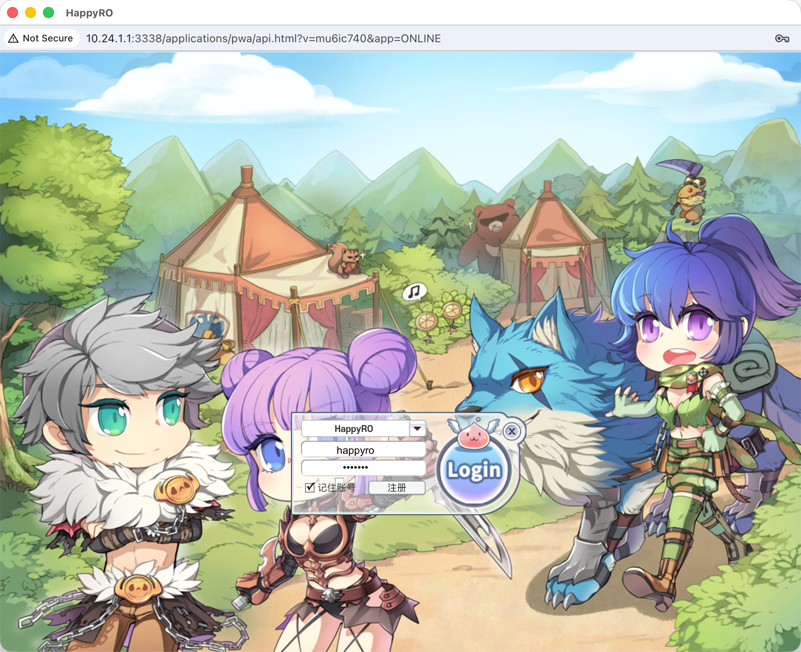

### 地图图鉴

地图图鉴支持按名称或代码搜索地图，并提供路线预览、自动寻路和地图传送功能。

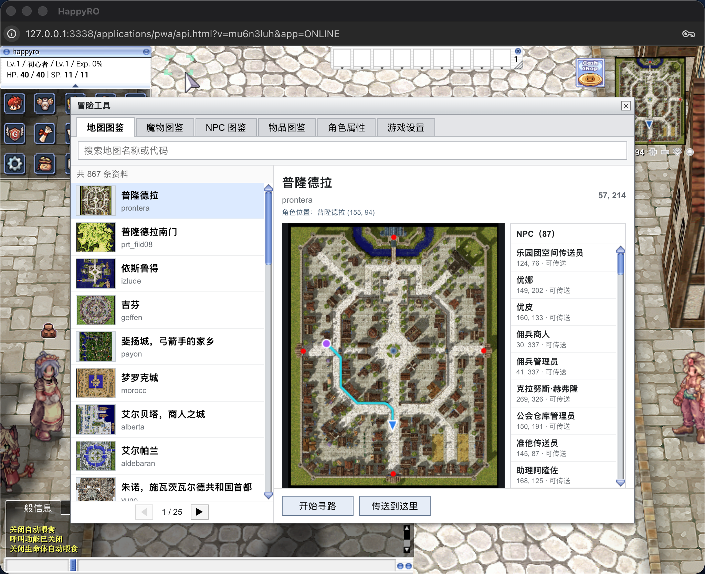

### 魔物图鉴

魔物图鉴展示等级、HP、种族、属性、经验、掉落物品和出现地图，并支持召唤魔物和传送到对应地图。

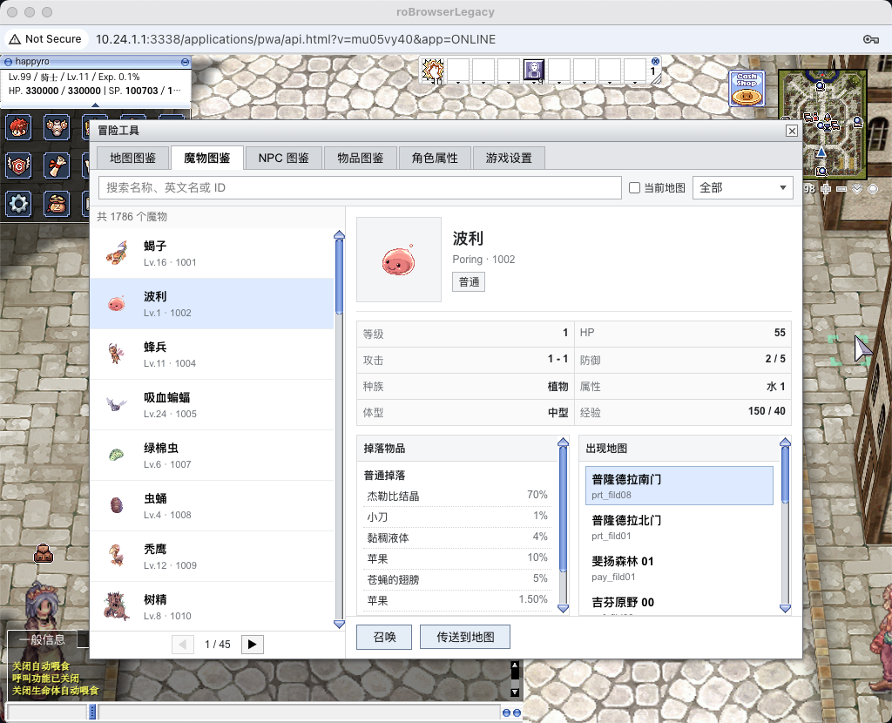

### NPC 图鉴

NPC 图鉴展示游戏中 NPC 的中文名称、图片、所在地图和精确坐标，并支持按当前地图筛选、地图定位和传送至 NPC 附近。

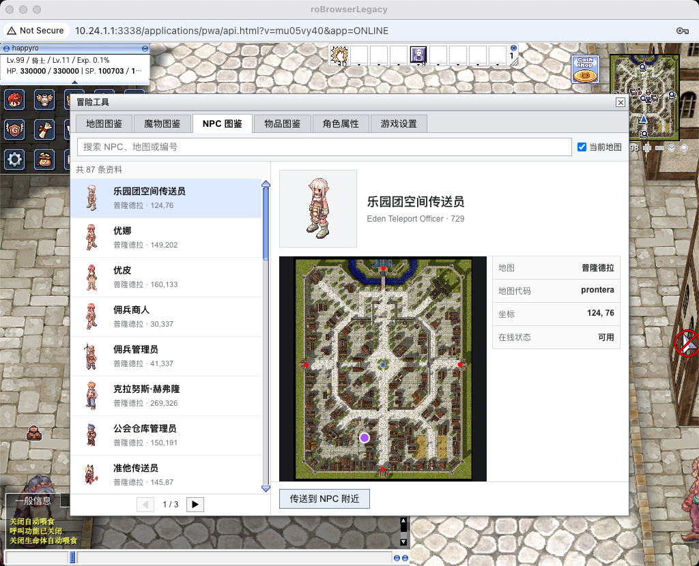

### 物品图鉴

物品图鉴支持按名称、AegisName 或 ID 搜索，展示图标、插画、类型、重量、价格、洞数和中文说明，并支持为当前角色添加物品或 Zeny。

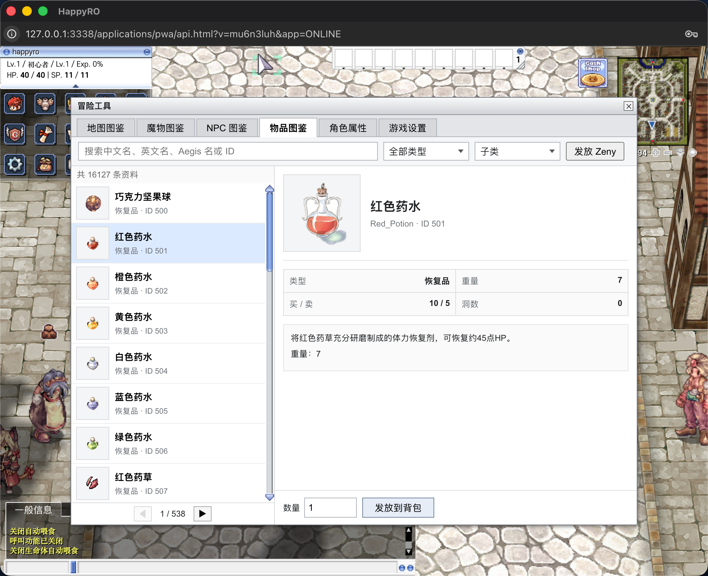

### 角色属性

角色属性页汇总职业、等级、技能点、基础属性和生命状态，并支持切换职业、调整等级与属性、恢复状态和重置加点。

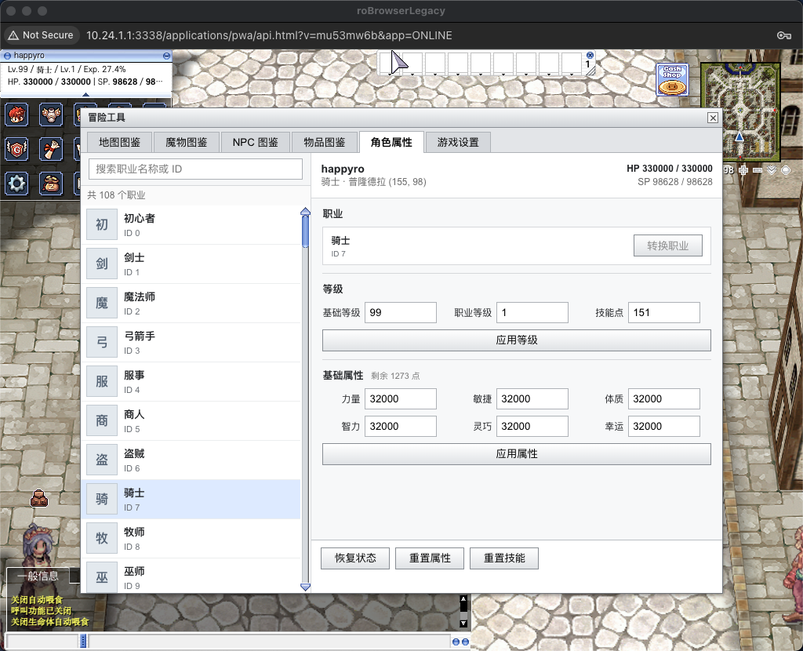

### 游戏设置

游戏设置支持调整经验和各类物品的掉落倍率，也可设置地图传送、地图分流和魔物召唤等功能。

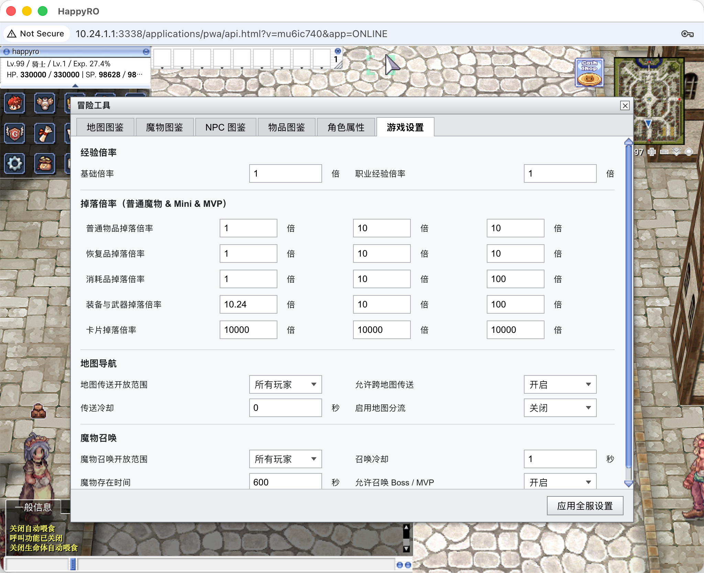

## 手机平板

### 游戏主界面

左侧拖动控制移动，点击 NPC 直接交谈、点击地面物品直接拾取；右下角六格快捷栏用于施放技能和使用道具。

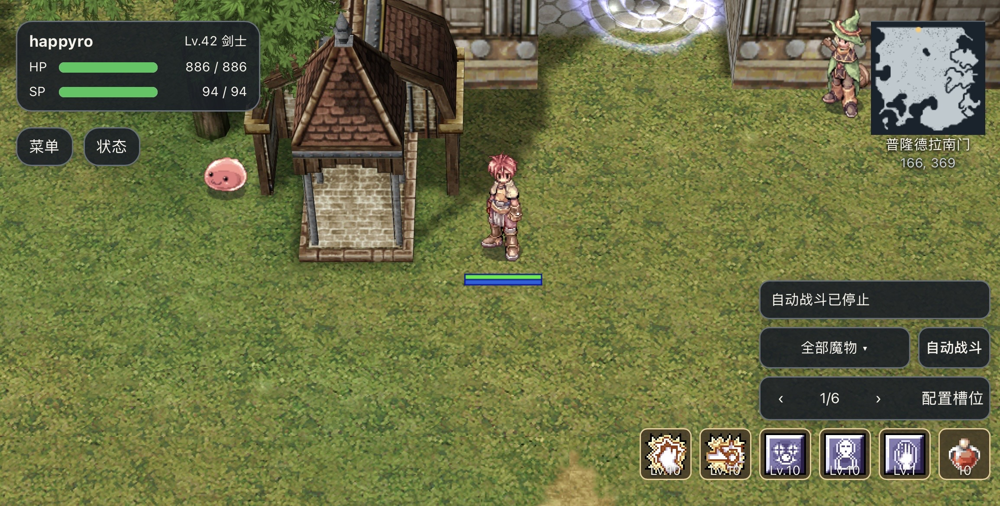

### 自动战斗

支持多选魔物种类、配置攻击技能和战斗范围；手动移动时暂停攻击，停止移动后继续，配置按角色保存在本机。

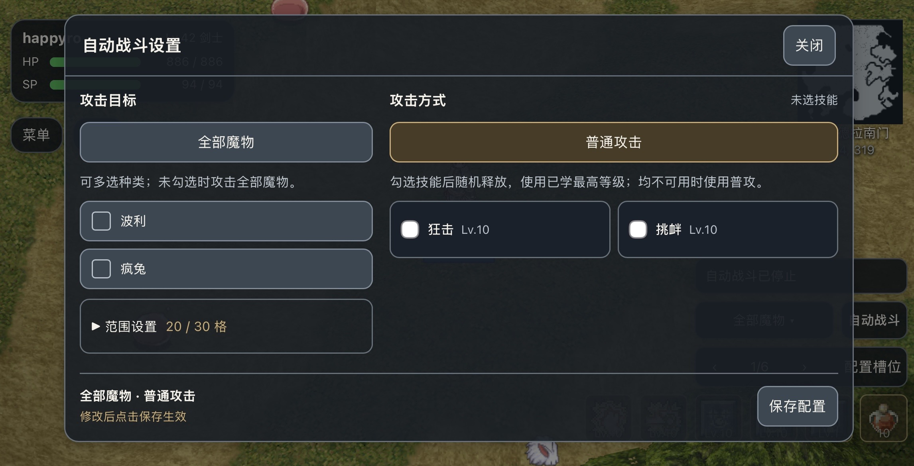

支持游戏中切换横竖屏，手机、平板及分屏按实际可用空间调整布局。可将 HTTPS 游戏启动页添加到桌面，以 PWA 方式隐藏浏览器工具栏。详细操作及添加步骤见[手机平板文档](https://happyro.kugarocks.com/game/mobile)。

## 游戏后台

HappyRO Admin 是独立的游戏管理后台，支持查询游戏资料、调整角色和修改游戏设置。[在线演示](https://happyro-admin.kugarocks.com)，默认账号为 `admin / admin`。

后台魔物图鉴支持按名称、种族、属性、体型筛选，并可查看魔物图片、属性和详情。

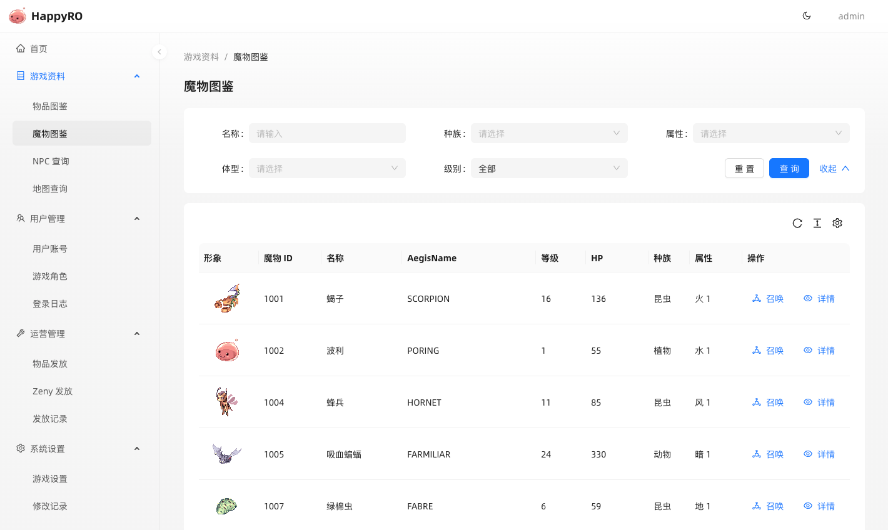

后台按类别展示游戏设置，可以分别调整经验和各类物品的掉落倍率。

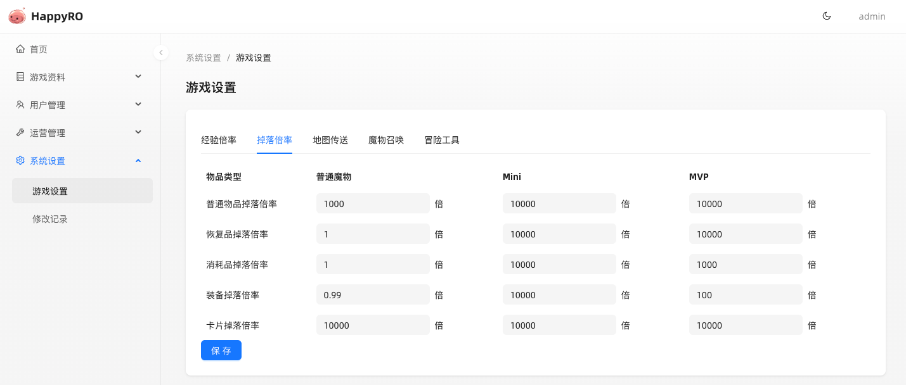

## 项目组成

HappyRO 由一个编排仓库、四个独立应用仓库和一个公开文档仓库组成：

| 仓库 | 职责 |
| --- | --- |
| 当前根仓库 | 部署脚本、配置、本地化资源、文档和发布编排 |
| [happyro-client](https://github.com/happyro/happyro-client) | 浏览器客户端、PWA 与游戏内冒险工具 |
| [happyro-server](https://github.com/happyro/happyro-server) | rAthena 登录、角色、地图和 Web API 服务 |
| [happyro-gateway](https://github.com/happyro/happyro-gateway) | Node.js 网关、静态资源、HTTP 与 WebSocket 代理 |
| [happyro-admin](https://github.com/happyro/happyro-admin) | 游戏后台、Laravel API 与 Ant Design Pro 前端 |
| [happyro-doc](https://github.com/happyro/happyro-doc) | 公开安装、玩家指南与文档站 |

详细调用关系见[系统概览](https://happyro.kugarocks.com/guide/introduction#运行关系)，各仓库职责见[项目组成](https://happyro.kugarocks.com/guide/introduction#项目组成)。

## 技术基线

| 项目 | 版本或基线 |
| --- | --- |
| kRO 客户端资源 | 2021-11-05（`RAG_SETUP_211105.exe`） |
| `PACKETVER` | `20211103` |
| 服务端模式 | Renewal |
| [rAthena](https://github.com/rathena/rathena) | `master` @ [`2fe6ab3dc4d8`](https://github.com/rathena/rathena/commit/2fe6ab3dc4d830b11d93fb44c3b48436571890bd) |
| [roBrowserLegacy](https://github.com/MrAntares/roBrowserLegacy) | `master` @ [`402e61ce7ae8`](https://github.com/MrAntares/roBrowserLegacy/commit/402e61ce7ae80cd45c76365371d4dbfd6aa10f49) |
| Node.js | 22 或更高版本 |
| MariaDB | 10.11 |
| LUB 工具链 | Lua 5.0.2、Lua 5.1.5 |

## 安装与开发

推荐使用[离线包](https://happyro.kugarocks.com/guide/downloads)部署 HappyRO。包内已包含双架构镜像、kRO 运行资源、配置模板和配套工具，只需提前安装 Docker Engine、Compose v2 和 Python 3.11+，即可按照[离线安装手册](https://happyro.kugarocks.com/container/docker)完成部署。

源码开发的依赖、资源准备、构建与服务启动见[本地开发手册](docs/development/workflow/local-setup.md)；Linux 使用 systemd，macOS 原生服务使用 launchd，具体入口见[服务管理](docs/operations/services.md)。不要将原生开发环境与 Docker 离线包的数据目录和端口混用。

离线包的默认公开地址适用于部署机器本机浏览器；局域网访问需按部署手册配置主机地址、端口和代理。本机开发 Gateway 的监听与访问范围以实际配置为准。

访问入口：

- 游戏：<http://127.0.0.1:3338/applications/pwa/index.html>
- 游戏后台：<http://127.0.0.1:8000>

依赖安装、资源准备和常用命令见[本地开发](https://happyro.kugarocks.com/native/linux)。

## 文档导航

- [v0.5.0 发布准备](changelog/releases/v0.5.0.md)：相对 v0.3.2 的变化、升级要求及待验收边界。
- [开发与维护总览](docs/README.md)：当前架构、开发、运维和本地化说明。
- [NPC 审读与验收边界](docs/localization/server-content.md#审读范围与未完成验收)：审读覆盖及仍需核验的玩法范围。
- [自定义功能实现](docs/architecture/customization.md)：NPC、数据库、资源及目录刷新机制。
- [Docker 部署与升级](docs/operations/docker-deployment.md)：定制操作、持久目录、备份恢复。
- [镜像构建与交付](docs/operations/docker-release.md)：完整打包流程与发布边界。
- [最终包验收清单](docs/operations/release-checklist.md)：双架构、升级回退、保持登录及跨端验收。

| 入口 | 内容 |
| --- | --- |
| [项目简介](https://happyro.kugarocks.com/guide/introduction) | 核心能力、项目组成、运行关系和技术基线 |
| [系统概览](https://happyro.kugarocks.com/guide/introduction#运行关系) | 浏览器、Gateway、Server 与 Admin 的运行关系 |
| [本地开发](https://happyro.kugarocks.com/native/linux) | 环境准备、构建、启动和检查 |
| [日常维护](https://happyro.kugarocks.com/container/docker#日常维护) | 服务状态、日志、重启和停止 |
| [离线安装](https://happyro.kugarocks.com/container/docker) | 完整离线包的获取、校验、初始化和启动 |
| [关于汉化](https://happyro.kugarocks.com/guide/localization) | 汉化流程、资源处理和已知局限 |
| [游戏图鉴与工具](https://happyro.kugarocks.com/game/desktop) | 地图、魔物、NPC、物品图鉴和角色维护 |
| [手机平板](https://happyro.kugarocks.com/game/mobile) | 触屏操作、快捷栏、自动战斗及 PWA 添加到桌面 |

## 站点与社区

- 项目站点：[happyro.kugarocks.com](https://happyro.kugarocks.com)
- GitHub Pages：[happyro.org](https://happyro.org)
- 安装教程：[Docker](https://happyro.kugarocks.com/container/docker) / [Linux](https://happyro.kugarocks.com/native/linux) / [macOS](https://happyro.kugarocks.com/native/macos) / [Windows](https://happyro.kugarocks.com/native/windows)
- QQ 群：`662191549`（HappyRO）

## 开源协议

[GNU General Public License v3.0](LICENSE)
