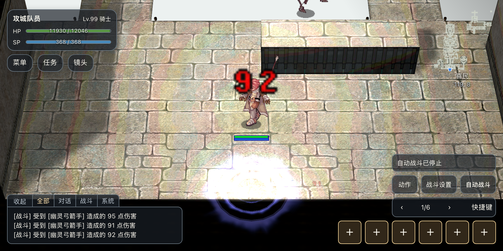
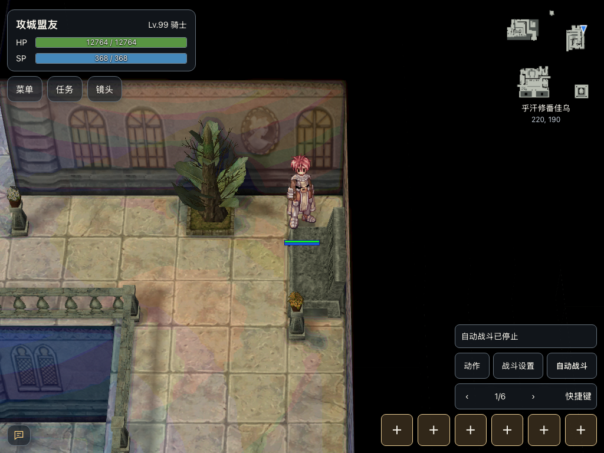
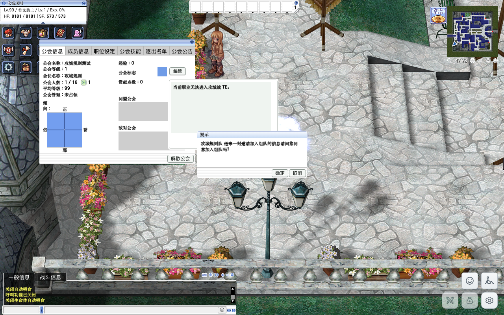
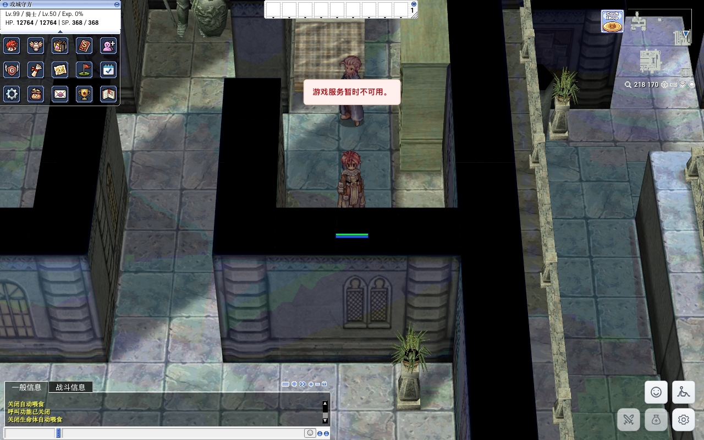

# 公会战正常入口验证

2026-10-29 对 FE、SE、TE 各一座代表城堡验证普通玩家入口，覆盖开战与关战、占城公会成员与非占城公会成员。管理命令只用于把测试角色放在入口外的可走位置；进入城堡由普通客户端步行请求触发实际传送点，旗帜由普通 NPC 对话完成。没有用管理传送到城内冒充正常入场。

## 普通步行入口

| 城堡 | 入口外地图与传送点 | 实际城内落点 | 开战／关战结果 |
| --- | --- | --- | --- |
| FE 高天鹅堡 `aldeg_cas02` | `alde_gld (95,253)` | `(88,163)` | 占城公会11与非占城公会12均可进入 |
| SE 喜民 `schg_cas01` | `sch_gld (293,90)` | `(119,8)` | 占城公会10与非占城公会12均可进入 |
| TE 格拉丽丝 `te_aldecas1` | `te_alde_gld (48,79)` | `(34,248)` | 符合职业条件的占城公会9与非占城公会12均可进入 |

步行证据记录了外部准备位置、客户端行走目标与最终地图／坐标：

- FE：[开战占城成员](./evidence/war-entry/entry-fe-current-ally.json)、[开战非占城成员](./evidence/war-entry/entry-fe-current-outsider.json)、[关战占城成员](./evidence/war-entry/entry-fe-off-ally.json)、[关战非占城成员](./evidence/war-entry/entry-fe-off-outsider.json)。
- SE：[开战占城成员](./evidence/war-entry/entry-se-on-member.json)、[开战非占城成员](./evidence/war-entry/entry-se-on-outsider.json)、[关战占城成员](./evidence/war-entry/entry-se-off-member.json)、[关战非占城成员](./evidence/war-entry/entry-se-off-outsider.json)。
- TE：[开战占城成员](./evidence/war-entry/entry-te-on-defender.json)、[开战非占城成员](./evidence/war-entry/entry-te-on-outsider.json)、[关战占城成员](./evidence/war-entry/entry-te-off-defender.json)、[关战非占城成员](./evidence/war-entry/entry-te-off-outsider.json)。

SE 从北侧 `(293,95)` 向入口步行。初次把角色放到南侧不可走地格导致无法移动，已通过地图格检查纠正准备位置，不作为入口故障。

## 旗帜入口

| 城堡 | 外部旗帜 | 占城公会实际落点 | 非占城公会 |
| --- | --- | --- | --- |
| FE | 高天鹅堡，`alde_gld (99,244)` | `aldeg_cas02 (220,190)` | 展示归属告示，留在外部地图 |
| SE | 喜民，`sch_gld (290,90)` | `schg_cas01 (120,290)` | 展示归属告示，留在外部地图 |
| TE | 格拉丽丝，`te_alde_gld (61,87)` | `te_aldecas1 (218,170)` | 展示归属告示，留在外部地图 |

上述结果均分别验证开战与关战：

- FE：[开战占城](./evidence/war-entry/entry-flag-fe-on-ally.json)、[关战占城](./evidence/war-entry/entry-flag-fe-off-ally.json)、[开战非占城](./evidence/war-entry/entry-flag-fe-on-outsider.json)、[关战非占城](./evidence/war-entry/entry-flag-fe-off-outsider.json)。
- SE：[开战占城](./evidence/war-entry/entry-flag-se-on-member.json)、[关战占城](./evidence/war-entry/entry-flag-se-off-member.json)、[开战非占城](./evidence/war-entry/entry-flag-se-on-outsider.json)、[关战非占城](./evidence/war-entry/entry-flag-se-off-outsider.json)。
- TE：[开战占城](./evidence/war-entry/entry-flag-te-on-defender.json)、[关战占城](./evidence/war-entry/entry-flag-te-off-defender.json)、[开战非占城](./evidence/war-entry/entry-flag-te-on-outsider.json)、[关战非占城](./evidence/war-entry/entry-flag-te-off-outsider.json)。

FE 旗帜流程要完成下一页、选择返回城堡、关闭对话，才执行后续传送。测试工具早期没有正确等待对话状态，误发菜单导致测试会话断开；重新登录后按真实移动端交互状态完成，并以实际落点验证。该准备／操作错误不作为产品入口缺陷。

## TE 职业限制与适用范围

非占城测试角色在二转牧师时可正常步行入场；临时改为三转符文骑士后，开战与关战都停在 `te_alde_gld (47,78)`，显示“当前职业无法进入攻城战 TE”。测试后恢复牧师。

[开战三转拒绝](./evidence/war-entry/entry-te-on-third-outsider.json)、[关战三转拒绝](./evidence/war-entry/entry-te-off-third-outsider.json)、[提示文字](./evidence/war-entry/entry-te-third-dialog.json)。

当前 `npc/re/warps/guildcastles.txt` 的正常入口使用 `jobcanentermap`，与旗帜职业检查方向一致。入口还包含 `WoeTETimeStart(3600)` 准备期的同盟准入分支；本次开关战矩阵不等于指定周期开战前一小时的定时准备期验证，未将该分支算入实测通过。

FE、SE 普通传送点本身没有“非占城公会禁止进入”的条件。关战仍能进入地图不等于可以攻击核心、抢占城堡，不能混为一项结论。

## SE 关战清理对照

入口关战测试前后另行读取服务端：关战前占城公会10、核心和相关设施共25个；关战后仍为公会10，对应核心／设施对象为0。[关战前](./evidence/war-entry/entry-se-before-end.json)、[关战后](./evidence/war-entry/entry-se-after-end.json)。该计数针对探针覆盖的核心及1905～1908设施，不代表地图所有怪物计数。

## 关键截图

