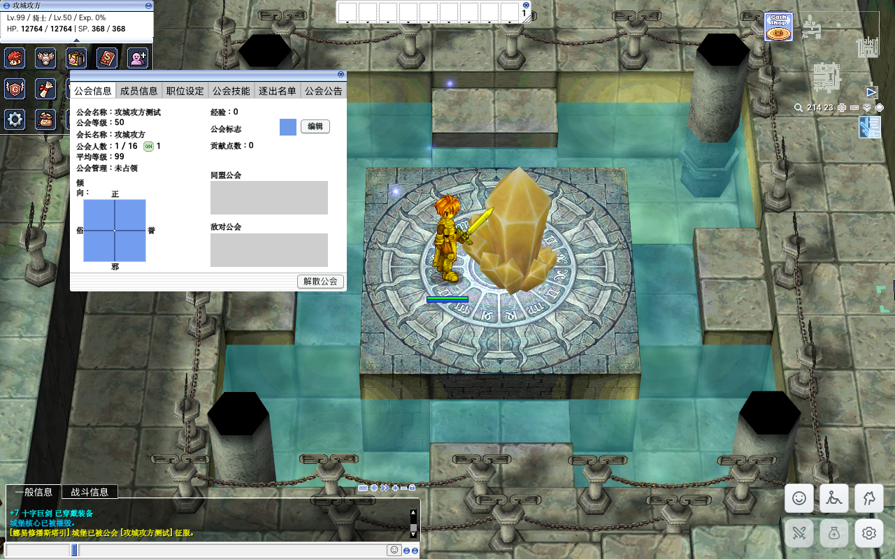
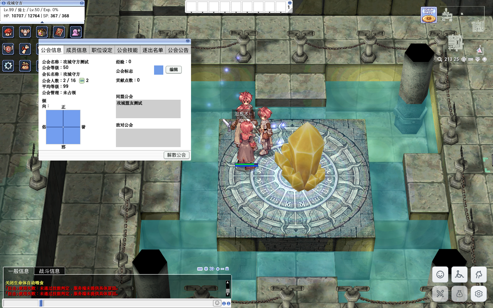

# FE 传统攻城实测

[返回公会审查](README.md)

2026-10-29，本机 Renewal / PACKETVER=20211103，构建 `mvt6t3kq`。使用独立普通权限测试角色与公会，管理工具只准备等级、装备、技能点和站位；被测占城使用真实普通攻击，没有直接改归属或击杀核心。

| 场景 | 实测结果 | 证据 |
| --- | --- | --- |
| 公会认可前置 | 未学习认可时攻击核心血量不变；通过普通客户端学习认可后可以攻击 | [未认可](evidence/war-fe/fe-no-approval.json)、[认可后](evidence/war-fe/fe-approved-start.json) |
| 正常占领 | 核心受到真实攻击，归属从无主变为公会10，生成新核心 | [攻击过程](evidence/war-fe/fe-progress.json)、[占领结果](evidence/war-fe/fe-captured.json) |
| 己方核心 | 占领后继续攻击己方核心，HP保持100 | [己方保护](evidence/war-fe/fe-own-core-protected.json) |
| 关战 | 已占城核心消失，城堡归属保留 | [关战结果](evidence/war-fe/fe-ended.json) |
| 同公会与联盟 | 普通攻击和狂击不造成伤害 | [本会普攻](evidence/war-fe/fe-same-guild-attack.json)、[联盟普攻](evidence/war-fe/fe-allied-guild-attack.json)、[联盟狂击](evidence/war-fe/fe-allied-guild-bash.json) |
| 敌对公会 | 普通攻击和狂击均造成正伤害 | [普攻](evidence/war-fe/fe-enemy-guild-attack.json)、[狂击](evidence/war-fe/fe-enemy-guild-bash.json) |

该轮测试还验证了战时联盟申请不能建立、关战后可建立联盟。治疗术对非不死目标可治疗敌方，双方对照均恢复 868 HP（[盟友](evidence/war-fe/fe-allied-guild-heal.json)、[敌方](evidence/war-fe/fe-enemy-guild-heal.json)），与原生技能实现一致，不将其当作敌我关系缺陷。跨公会同队的保护规则见[战场规则](war-rules.md)，不能简单归纳为“不同公会一定互相伤害”。

投资、卡普拉、守护者和宝箱的独立实际流程见[城堡管理](war-management.md)。本页使用代表城堡验证共享攻城逻辑，不宣称逐座城堡重复完整攻防；52张地图资源与门户另见[攻城地图审查](maps/README.md)。
