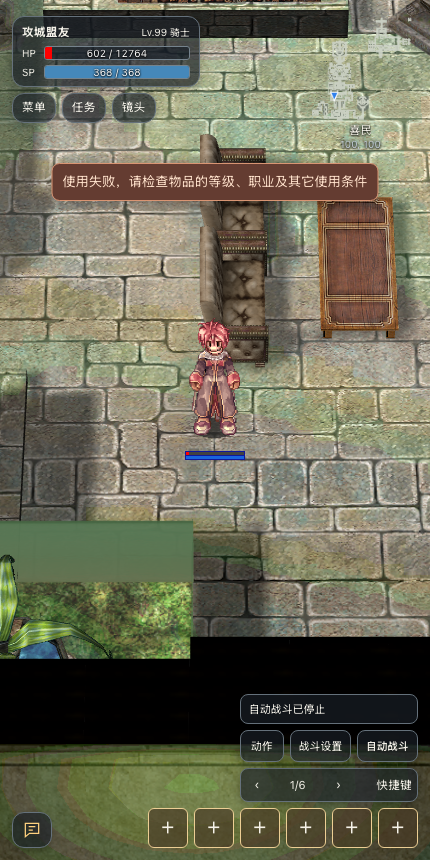
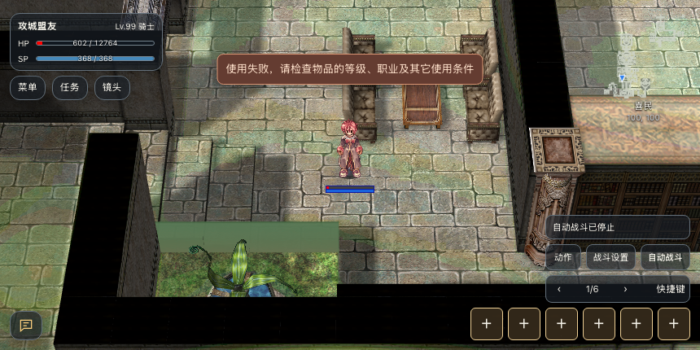
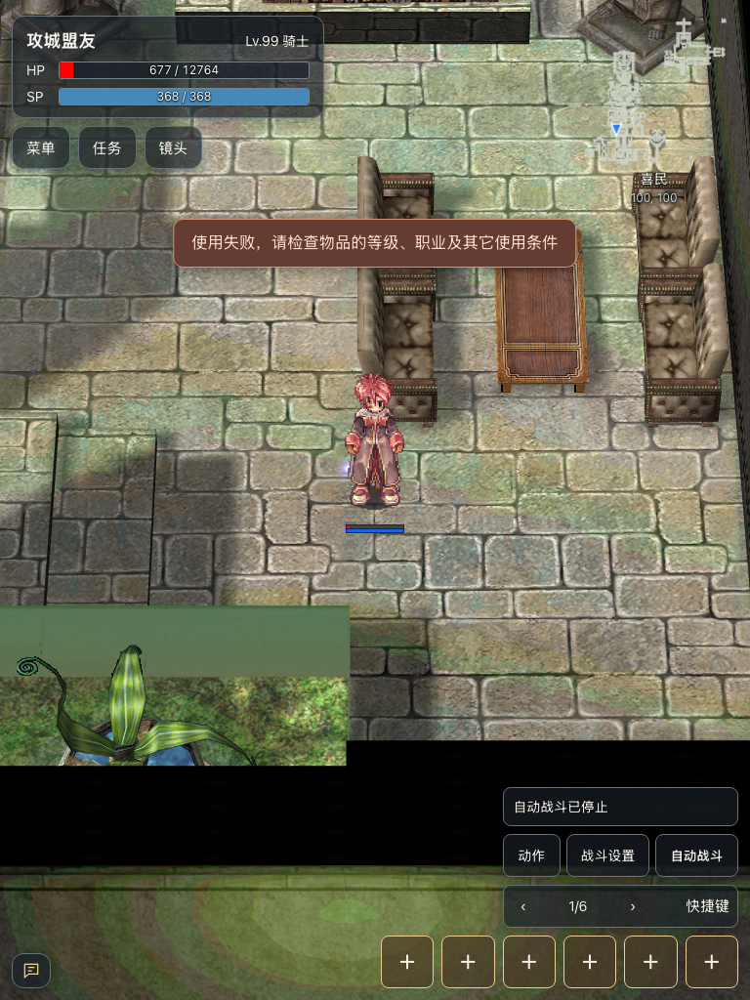
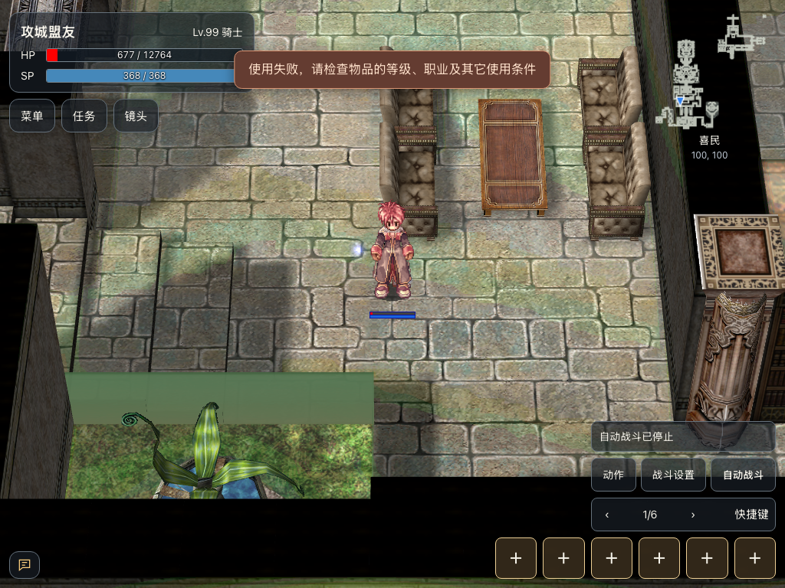

# 公会战通用规则实机验证

本页记录 2026-10-29 本机当前工作区的验证，使用 Renewal、PACKETVER=20211103。主要场地为 SE `schg_cas01`，普通地图对照为 `prontera`。结论限于本次配置和实际用例，不代表所有地图或职业组合已覆盖。

## 测试方法与边界

测试账号为独立普通权限角色。创建角色、分配装备与学习前置所需资源属于准备；攻击、使用道具、释放技能、建队和接受邀请通过真实客户端请求发送。复活对照使用管理命令使目标死亡，仅用于准备死亡状态，不作为战斗击杀证据。

无公会攻击对照前，隔离坐标约 `(95,100)` 周围的环境怪物，排除城堡核心和防御设施；不把清怪动作算作攻城完成。早期混有环境怪物伤害的记录已排除，使用包含施攻者、目标与伤害的 `NOTIFY_ACT3` 作为依据。

## 验证结果

| 项目 | 实际结果 | 证据 |
| --- | --- | --- |
| 苍蝇翅膀 | SE 内不可使用；数量保持 10，地图与位置不变 | [使用前后](./evidence/war-rules/rules-se-fly-wing.json) |
| 蝴蝶翅膀 | 可以回保存点；数量 10→9，返回 prontera | [使用前后](./evidence/war-rules/rules-se-butterfly-wing.json) |
| 无公会玩家 | 可受到其他公会玩家普通攻击；有明确正伤害包 | [伤害记录](./evidence/war-rules/rules-isolated-noguild-hits.json) |
| 跨公会同队 | 当前配置下同队受保护；退出队伍后，同位置立即受到 342 等正伤害 | [同队](./evidence/war-rules/rules-cross-guild-party-protected.json)、[退队对照](./evidence/war-rules/rules-cross-guild-after-party-leave.json) |
| 战场死亡 | 收到角色死亡通知后，自动返回保存点 | [死亡与落点](./evidence/war-rules/rules-gvg-death-auto-respawn.json) |
| 非 GvG 紧急呼叫 | 已学习技能仍被服务端拒绝 | [拒绝记录](./evidence/war-rules/rules-recall-outside-gvg-rejected.json) |
| 战场紧急呼叫 | 将公会成员从 TE 场地召至 SE 会长附近 | [召回落点](./evidence/war-rules/rules-recall-member-arrival.json) |
| 立即重复紧急呼叫 | 服务端拒绝，返回 `cause=4` | [冷却拒绝](./evidence/war-rules/rules-recall-immediate-cooldown.json) |
| 冷却到期与重登保存 | 到期后再次成功召回；会长重新登录后仍收到冷却拒绝 `cause=4` | [到期后的落点](./evidence/war-rules/recall-after-cooldown-arrival.json)、[重登后拒绝](./evidence/war-rules/recall-relogin-cooldown.json) |
| 四级复活术 | 普通地图复活死亡目标成功；SE 收到 `SKID=54,result=0` 拒绝，目标自动回保存点 | [普通地图](./evidence/war-rules/rules-revive-prontera-skill.json)、[SE](./evidence/war-rules/rules-revive-schg_cas01-skill.json) |
| 天地树叶子 | 普通地图成功复活；SE 使用消耗道具，但未阻止目标自动返回保存点 | [普通地图](./evidence/war-rules/rules-revive-prontera-leaf.json)、[SE](./evidence/war-rules/rules-revive-schg_cas01-leaf.json) |

### 应如何理解这些规则

“禁止瞬移”不等于“禁止回保存点”。苍蝇翅膀受 `noteleport` 与 GvG 判定限制；蝴蝶翅膀检查 `noreturn`，本次城堡没有启用该限制，因此可以使用。

当前跨公会同队保护与 `battle.cpp` 的关系判断一致：只有地图启用 `gvg_noparty` 时，才忽略同队保护。因此不能把“不同公会但同队不能互相攻击”直接判为缺陷。

GvG 死亡后服务端安排约 1 秒自动回保存点。四级复活术为即时施放，本次在死亡通知后约 50ms 发出客户端请求，明确收到战场拒绝。树叶使用一级复活术，具有基础吟唱时间；本次没有收到同样的即时拒绝包，目标先离开战场。因此树叶的证据证明的是“消耗道具但未在战场复活目标”，不能声称收到明确拒绝包，也不能仅凭此推断所有加速吟唱组合。

四次复活对照后，蓝色魔力矿石 50→48，树叶 10→8：本次 SE 尝试也发生消耗。[最终道具数量](./evidence/war-rules/rules-revive-final-consumables.json)。

## 移动端截图检查

使用同一触屏浏览器会话调整视口，检查手机与平板横竖屏布局，不等同于四台真实设备测试。四图均已目视检查：失败提示文字可见、未被裁切；主操作栏与快捷栏可见。当前提示为通用“使用失败，请检查物品的等级、职业及其它使用条件”，没有明确指出城堡禁止瞬移；这属于提示精确度限制，不能把截图当成特定失败原因的协议证据。

| 手机竖屏 430×860 | 手机横屏 860×430 |
| --- | --- |
|  |  |

| 平板竖屏 768×1024 | 平板横屏 1024×768 |
| --- | --- |
|  |  |

复活截图为动作结束后的目标视角，需结合上方协议记录理解，不能单凭截图证明技能释放过程：[普通地图复活后](./evidence/war-rules/rules-revive-prontera-skill.png)、[SE 自动回保存点后](./evidence/war-rules/rules-revive-schg_cas01-skill.png)。
